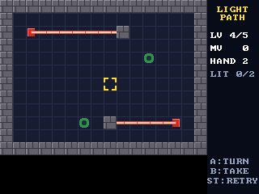
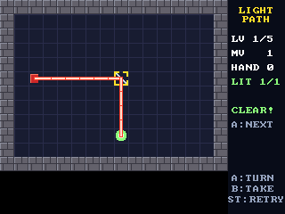

# LIGHT PATH（光路反射）

| 開局（第 4 關） | 過關（第 1 關） |
| :---: | :---: |
|  |  |

RP2040 復古掌機的光路益智遊戲：轉動、搬動鏡子，把發射器射出的光導到每一個接收器，
全部點亮就過關。也是 [rp2040-retro-sdk](https://github.com/pondahai/rp2040-retro-sdk) 的**第一款原生遊戲**與完整範例。

| 按鍵 | 作用 |
| :--- | :--- |
| 方向鍵 | 移動游標 |
| A | 旋轉鏡子；過關後進下一關 |
| B | 拿起鏡子／在空地放下一面 |
| START | 重來這一關；全破後從第 1 關開始 |

- 光遇到鏡子轉 90°，遇到牆、發射器、接收器或盤面邊緣就停
- 有底座的固定鏡不能動；右側面板顯示關卡、步數、手上的鏡子數、已點亮的接收器
- 內建 5 關；SD 卡放 `lightpath.lvl` 就取代內建關卡，進度與每關最少步數存在 `lightpath.sav`
- 沒插卡也能玩，只是不存檔

## 這個範例示範了什麼

| 檔案 | 內容 |
| :--- | :--- |
| `game.c` / `game.h` | 純 C 遊戲邏輯（盤面、光線追蹤、過關判定），不碰硬體也不碰繪圖 |
| `levels.c` | 關卡是 16×12 的 ASCII 字串，字元定義見 `game.h` |
| `scene.c` | 分條渲染畫面（tilemap + 光束 + 側邊面板），實機與 PC 預覽共用 |
| `art.c` | 用程式產生的 tile 圖 |
| `pack.c` | 關卡檔／存檔的文字格式解析 |
| `main.c` | 主迴圈：按鍵、音效、SD 讀寫 —— 唯一碰硬體的地方 |
| `test/test_game.c` | PC 測試：每關「開局沒過、照解法擺會過」 |
| `pc/preview.c` | 在電腦上把畫面存成 PNG |
| `tools/make_cover.py` | 產生載入器選單封面 `assets/LIGHTPATH.RAW` |

## 編譯與上機

SDK 以 git submodule 放在 `sdk/`，clone 時一起抓：

```bash
git clone --recursive https://github.com/pondahai/rp2040-lightpath
cd rp2040-lightpath
cmake -B build_offset -G Ninja -DLOADER_OFFSET_BUILD=ON
ninja -C build_offset lightpath_run   # 推上掌機並啟動
```

工具鏈設定見 SDK 的 [GETTING-STARTED.md](https://github.com/pondahai/rp2040-retro-sdk/blob/main/docs/GETTING-STARTED.md)。
產出 `lightpath.uf2`（載入器選單版，搭配封面 `LIGHTPATH.RAW`）與 `lightpath_standalone.uf2`（BOOTSEL 直接燒）。

## 在電腦上預覽與測試

```bash
sh pc/build.sh              # 編譯並跑 test_game
build_pc/preview out.png 4  # 第 4 關開局
build_pc/preview out.png 1 UA # 第 1 關：游標上移、轉鏡子 → 過關
```

按鍵序列：`L R U D` 移動、`A` 旋轉、`B` 拿放、`S` 重來、`N` 下一關。
`preview --dump-levels lightpath.lvl` 把內建關卡匯出成關卡檔，可以拿來改。

## 授權

MIT
